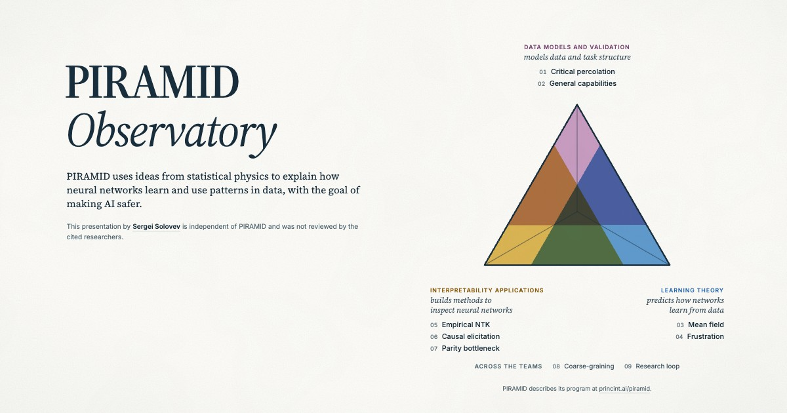
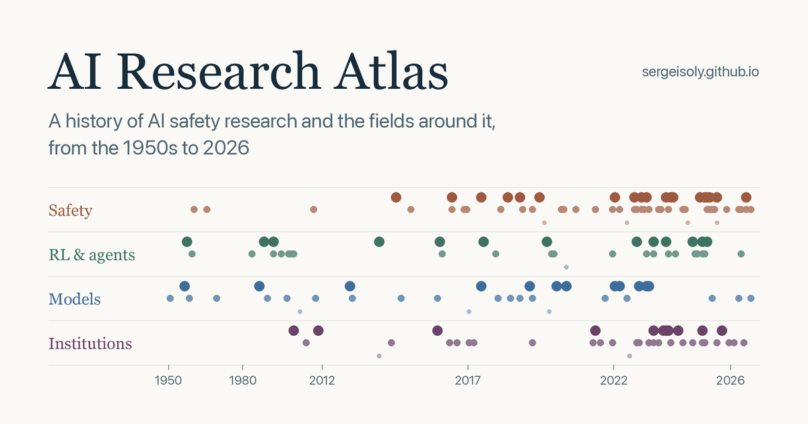

```{=html}
<ul class="project-list">
  <li><a href="/piramid-observatory/">
    
    <span class="project-name">PIRAMID Observatory</span>
    <span class="project-description">Explore how researchers test what neural networks learn, with interactive figures and small experiments you can run in your browser.</span>
  </a></li>
  <li><a href="/projects/ai-research-atlas/">
    
    <span class="project-name">AI Research Atlas</span>
    <span class="project-description">Trace the history of AI safety alongside reinforcement learning and language models. Follow a reading route from the map to the original papers.</span>
  </a></li>
</ul>
```
